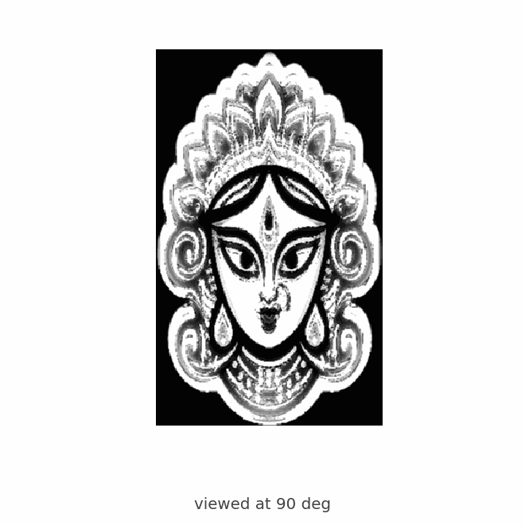
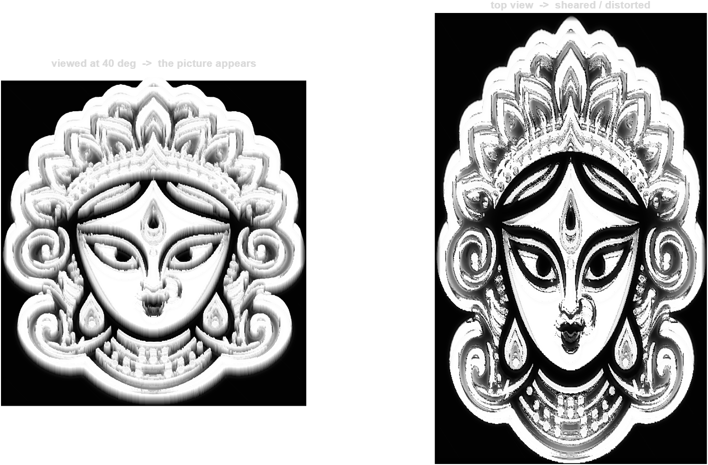

# MATLAB Durga - Anamorphic Relief Toolkit

Turn an **SVG line drawing** or a **raster photo/logo** into a smooth 3-D
printable relief, including an **anamorphic** plate whose picture only snaps into
place when it is viewed from one chosen angle.

The demo model is a relief of Maa Durga built from a photo; the same code turns
any SVG or bitmap into a relief.

---

## Demo

A short clip - the plate rotating from directly overhead (picture sheared into
bands) down to the 40 deg reading angle, where the face snaps together:



The same thing in stills. **Left:** seen at the reading angle - the picture
appears. **Right:** the plate from directly above - stretched into bands.



What the camera actually sees at 40 deg (reconstructed straight from the
height field):


A small down-sampled copy of the model for a quick look is included at
[`models/durga_anamorphic_demo.stl`](models/durga_anamorphic_demo.stl) (~4.8 MB,
watertight, printable). The full-resolution STL is roughly 75 MB and is not
committed.

---

## The anamorphic effect

An anamorphic relief has a **non-uniform** elevation: each point's height feeds
back into its vertical screen position, so the flat 2-D drawing only resolves
when the plate is viewed from one chosen elevation. From every other angle it
reads as sheared ridges.

```
screen row  V(Y) = Y*sin(el) + Z(Y)*cos(el)
height      Z(Y) = amp * H(V)            H = the drawing
```

`el` is the reading angle. The geometry is built from the source's own height
field, with one uniform mm scale on X, Y and Z.

```matlab
addpath('src')

% photo -> anamorphic plaque reading at 40 deg
run('examples/run_anamorphic_photo.m')   % -> output/durga_anamorphic_photo.{stl,png}

% any SVG at any angle
svgToAnamorphic('assets/durgamaa_svg.svg', struct('angle', 45, 'res', 620));
```

---

## Tools

| Tool | Purpose |
|------|---------|
| `svgToEquations.m` | Parse the SVG path grammar; rewrite every curve as a parametric cubic Bezier -> `.txt` (LaTeX), a self-contained **Desmos** `.html`, and a `.png` preview. |
| `writeDurgaSTL.m` | Stream a height-map grid to a watertight **binary STL** without the out-of-memory crashes of `triangulation` + `stlwrite`. |
| `reliefWriteSTL.m` | Write a **thin, print-friendly** relief (flat back, shallow `plate + relief` band). |
| `svgToRelief.m` | Any SVG -> smooth 3-D **height field**. |
| `imageToRelief.m` | Any raster (PNG/JPEG) -> smooth 3-D height field. |
| `svgTo3D.m` / `imageTo3D.m` | One call: source -> thin STL + preview. |
| `svgToAnamorphic.m` / `imageToAnamorphic.m` | Source -> anamorphic plaque (picture at one angle). |
| `figureToSTL.m` | Export the surface shown in a MATLAB figure straight to STL. |

---

## `imageToAnamorphic` options

| Field | Default | Meaning |
|-------|---------|---------|
| `angle` | `40` | Viewing elevation `el` in degrees. |
| `res` | `600` | Raster resolution (longest side, px). |
| `invert` | `false` | Raise dark pixels (line art). |
| `blur` | `0.02` | Volume softness (fraction). |
| `detail` | `0.004` | Detail radius (fraction). |
| `sharp` | `0.50` | High-pass weight. |
| `gain` | `3.0` | `tanh` cap steepness. |
| `feather` | `0.04` | Edge feather width. |
| `widthMM` | `150` | Longest side of the part (mm). |
| `depthFrac` | `0.04` | Relief height as a fraction of width. |
| `baseMM` | `1.5` | Base plate thickness (mm). |
| `outdir`, `outBase`, `render`, `writeSTL` | | Output location, base name, preview and STL toggles. |

`depthFrac` and `sharp` trade off against each other: raising `sharp` digs dark
features deeper, lowering `depthFrac` flattens the plate.

---

## Requirements

- **MATLAB R2020a+** (`exportgraphics` is used for previews).
- **Image Processing Toolbox** (for the raster/anamorphic paths:
  `imread`, `imgaussfilt`, `imfilter`).
- Base MATLAB is enough for the SVG/equation path.

See [SETUP.md](SETUP.md) for first-run steps and
[docs/ARCHITECTURE.md](docs/ARCHITECTURE.md) for how the functions fit together.

---

## Repository layout

```
MATLAB_Durga_Demo/
+-- README.md
+-- SETUP.md
+-- .gitignore
+-- docs/
|   +-- ARCHITECTURE.md      how the functions interrelate
|   +-- IMPLEMENTATION.md    what was built and how
+-- src/                     the toolkit (see ARCHITECTURE.md)
+-- media/                   demo visuals
|   +-- anamorphic.gif       rotation reveal (overhead -> 40 deg)
|   +-- preview.png          reading angle vs overhead
|   +-- seen.png             reconstruction at the reading angle
+-- models/                  small printable sample of the model
|   +-- durga_anamorphic_demo.stl
+-- examples/                one runnable script per scenario
|   +-- run_anamorphic_photo.m   raster -> anamorphic plaque (the demo)
|   +-- run_anamorphic.m         SVG -> anamorphic plaque
|   +-- run_anamorphic_any_svg.m any SVG -> anamorphic plaque
|   +-- run_image_relief.m       raster -> thin relief
|   +-- run_svg_relief.m         SVG -> thin relief
|   +-- run_equations.m          SVG -> parametric equations
|   +-- run_equation_stl.m       SVG equations -> STL
|   +-- run_extrude_demo.m       small height map -> STL
|   +-- run_smooth_medallion.m   equation-built gold medallion
+-- assets/
    +-- durgamaa_svg.svg     the line-art tracing (source vector)
    +-- main_clean.png       the reference photo
```
