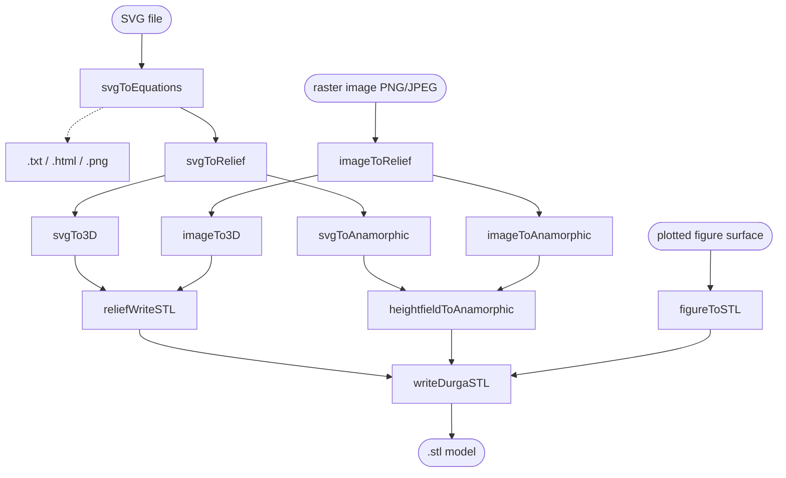
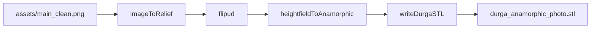
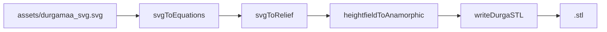
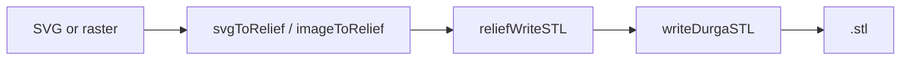

# Architecture - how the functions fit together

Three **core primitives**, a set of **height-field builders**, and a few
**one-call pipelines** that chain them.

---

## 1. The three core primitives

| Function | Input | Output | Role |
|----------|-------|--------|------|
| `writeDurgaSTL.m` | `X,Y,Z` grid, filename | triangle count | Streams a watertight **binary STL** (front + back plate + walls) with a tiny buffer. |
| `heightfieldToAnamorphic.m` | height field `H` `[0,1]` | `X,Y,Z` + STL | The **anamorphic engine**: `screen V = Y*sin(el) + Z*cos(el)`, `Z = amp*H(V)`. |
| `svgToEquations.m` | SVG | cubic Beziers + `.txt`/`.html`/`.png` | The **SVG parser** (also used head-less with `write=false`). |

---

## 2. Builders, writers and pipelines

| Layer | Function | Uses |
|-------|----------|------|
| Builder | `svgToRelief.m` | `svgToEquations` |
| Builder | `imageToRelief.m` | - |
| Writer | `reliefWriteSTL.m` | `writeDurgaSTL` |
| Writer | `figureToSTL.m` | `writeDurgaSTL` |
| Pipeline | `svgTo3D.m` | `svgToRelief` + `reliefWriteSTL` |
| Pipeline | `imageTo3D.m` | `imageToRelief` + `reliefWriteSTL` |
| Pipeline | `svgToAnamorphic.m` | `svgToRelief` + `heightfieldToAnamorphic` |
| Pipeline | `imageToAnamorphic.m` | `imageToRelief` + `heightfieldToAnamorphic` |

---

## 3. Dependency graph



Solid arrows are calls; the dotted arrow is optional file output.

---

## 4. Data flow

**Raster -> anamorphic (the demo)**



**SVG -> anamorphic**



**Any source -> thin relief**



---

## 5. Conventions across files

- **Height fields are `[0,1]`**, `ny-by-nx`. The engine renormalises defensively.
- **Row order differs by design**: `imageToRelief` puts row 1 at the **top** (so
  callers `flipud` before the anamorphic engine); `svgToRelief` has row 1 at the
  **bottom**.
- **One uniform mm scale** on X, Y and Z is what makes the oblique view
  reconstruct the picture - do not scale Z independently.
- `output/` and `*.stl` are git-ignored; published models are force-added.

---

## 6. Files by layer

```
src/
  writeDurgaSTL.m            core: watertight binary STL writer
  heightfieldToAnamorphic.m  core: anamorphic engine
  svgToEquations.m           core: SVG -> Beziers / txt / html / png
  svgToRelief.m      builder svgToEquations -> height field
  imageToRelief.m    builder raster -> height field
  reliefWriteSTL.m   writer  thin plaque -> writeDurgaSTL
  figureToSTL.m      writer  figure surface -> writeDurgaSTL
  svgTo3D.m          pipeline svgToRelief -> reliefWriteSTL
  imageTo3D.m        pipeline imageToRelief -> reliefWriteSTL
  svgToAnamorphic.m  pipeline svgToRelief -> heightfieldToAnamorphic
  imageToAnamorphic.m pipeline imageToRelief -> heightfieldToAnamorphic
examples/            one runnable script per scenario
assets/              durgamaa_svg.svg (vector), main_clean.png (photo)
```

See also: [../README.md](../README.md), [IMPLEMENTATION.md](IMPLEMENTATION.md).
